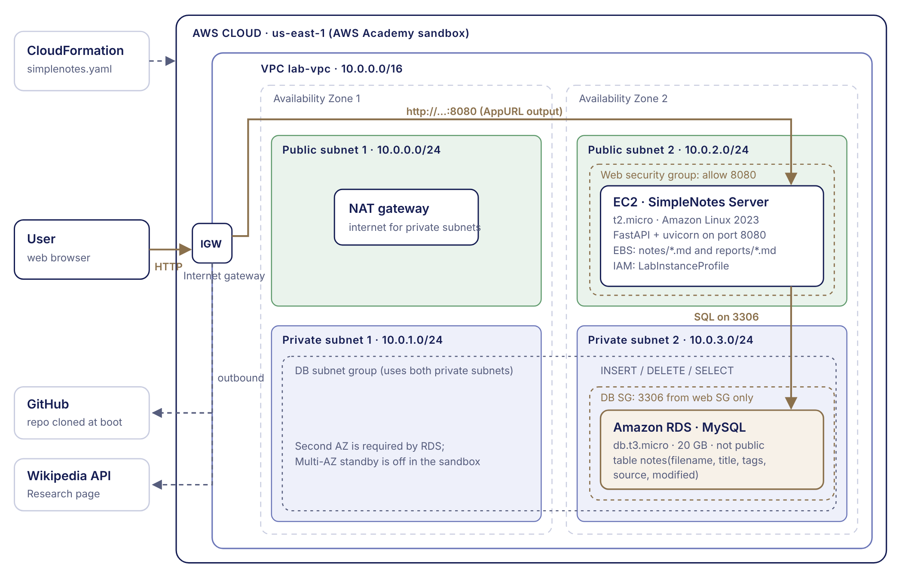
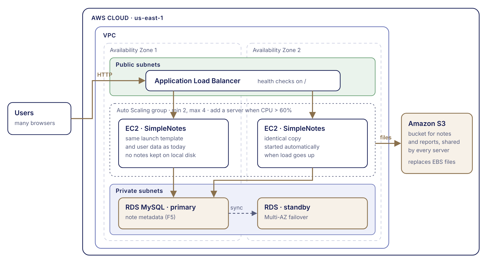

# SimpleNotes

A simple Markdown note-taking web app, inspired by [flatnotes](https://github.com/dullage/flatnotes).
Every note is a plain `.md` file on disk; a small SQL table (Amazon RDS MySQL on AWS) keeps each
note's metadata so notes can be filtered with a database query.

Group project for **DS600 Cloud Computing for Economics** (SMU). The whole environment is deployed
on the AWS Academy Sandbox with one CloudFormation template.



## Course requirements (F1–F6)

| # | Requirement | How SimpleNotes meets it | Course link |
| - | ----------- | ------------------------ | ----------- |
| F1 | One interface that brings the information together | One page: note list, editor with live preview, 📊 Stats and 🔎 Research | — |
| F2 | Company comparison | Not needed: the instructor approved a note-taking app instead of the finance features | — |
| F3 | Store analysis results | **Save Report** writes the current statistics to `reports/*.md`; **Previous Reports** opens them again | Lesson 7 (storage, EBS) |
| F4 | Store user data | Each note is a Markdown file in `data/`, on the EC2 instance's EBS volume | Lesson 7 (storage, EBS) |
| F5 | Database: store metadata and query it | Table `notes` in **Amazon RDS for MySQL** (private subnets); saving a note runs `INSERT`, deleting runs `DELETE`, the Stats page filters with `SELECT` | Lesson 8 (RDS) |
| F6 | Scalability | Design: load balancer + Auto Scaling group, notes moved to S3, RDS Multi-AZ (see [Scaling out](#scaling-out-f6)) | Lessons on ELB and Auto Scaling |
| Extra | External data | Research page searches Wikipedia's free API and saves articles as notes | — |
| Extra | Infrastructure as Code | `scripts/simplenotes.yaml` builds the VPC, EC2 and RDS in one step | Lessons 5–6 (CloudFormation) |

## Features

- Create, view, edit, rename and delete notes
- Markdown editor with live preview
- Full-text search across titles and content (press `/` to jump to the search box)
- Tags: write `#tag` anywhere in a note, then click the tag in the sidebar to filter
- Links between notes: write `[[Another Note Title]]`
- **Note Analytics** (📊 Stats): number of notes, total / average words, reading time,
  an activity chart for the last 14 days, top tags, top words, and every note ranked by length
- **Saved reports**: click **Save Report** to save the current statistics as a Markdown file;
  pick one under **Previous Reports** and click **Show** to open it again
- **Research** (🔎): search Wikipedia from inside the app and click **Save as note** to turn an
  article summary into a note, with a link back to the source and the tags `#wikipedia #research`
- **Find notes in the database** (bottom of the Stats page): filter notes by tag and/or source
  (own note or Wikipedia). The page also shows the exact SQL query that ran
- Optional username / password login (HTTP Basic Auth)
- `Ctrl+S` to save; SMU colours with a light / dark switch (🌙 next to Stats); works on mobile screens

## Tech Stack

| Part     | Technology                                                                 |
| -------- | -------------------------------------------------------------------------- |
| Backend  | Python 3.10+, FastAPI, Uvicorn                                             |
| Frontend | Plain HTML / CSS / JavaScript (marked.js for Markdown, DOMPurify for safety) |
| Storage  | Markdown files on the local file system (EBS on AWS)                       |
| Database | Amazon RDS for MySQL on AWS (`pymysql`); SQLite file `notes.db` when running locally |
| External data | Wikipedia REST API (free, no API key), called with Python's built-in `urllib` |
| Hosting  | AWS EC2 (deployed with CloudFormation)                                     |

## Project Structure

```
simplenotes/
├── app/
│   ├── main.py          # Backend: API routes, file storage, analytics, optional login
│   ├── db.py            # Note metadata table: SQLite locally, RDS MySQL on AWS
│   └── static/          # Frontend: the web page the user sees
│       ├── index.html   # Page layout (sidebar, viewer, editor, stats page)
│       ├── app.js       # Page logic: calls the API and updates the page
│       └── style.css    # Styling
├── data/                # Notes are saved here (created automatically, not in Git)
├── reports/             # Saved analytics reports (created automatically, not in Git)
├── docs/                # F5 plan for the team, architecture diagrams
├── scripts/             # CloudFormation templates for AWS
├── requirements.txt     # Python packages
├── run_local.bat        # Windows: double-click to start the app on http://localhost:8000
└── README.md
```

## Installation (run locally)

**Quick start on Windows:** double-click `run_local.bat`. It creates the virtual environment,
installs the packages and starts the app on http://localhost:8000. Keep its window open while
you use the app.

The manual steps below work on any system. You need **Python 3.10 or newer** (the code uses the `str | None` syntax).
Check your version first:

```bash
python --version
```

**Step 1 — Get the code**

```bash
git clone https://github.com/<your-username>/simplenotes.git
cd simplenotes
```

**Step 2 — Create and activate a virtual environment**

Windows (PowerShell):

```powershell
python -m venv .venv
.\.venv\Scripts\activate
```

macOS / Linux:

```bash
python3 -m venv .venv
source .venv/bin/activate
```

**Step 3 — Install the packages**

```bash
pip install -r requirements.txt
```

**Step 4 — Start the app**

```bash
uvicorn app.main:app --reload --port 8080
```

**Step 5 — Open it**

Go to http://localhost:8080 in your browser. Create a note, then check that a new `.md` file
appears in the `data/` folder.

## Configuration (environment variables)

| Variable       | Default | Meaning                                              |
| -------------- | ------- | ---------------------------------------------------- |
| `NOTES_DIR`    | `data`  | Folder where notes are stored (relative paths are resolved from the project folder) |
| `REPORTS_DIR`  | `reports` | Folder where analytics reports are stored (relative paths are resolved from the project folder) |
| `APP_USERNAME` | `admin` | Login username                                       |
| `APP_PASSWORD` | (empty) | Login password. **If empty, no login is required.**  |
| `DB_HOST`      | (empty) | RDS endpoint. **If empty, the app uses the local SQLite file `notes.db`.** |
| `DB_NAME`      | `simplenotes` | MySQL database name                            |
| `DB_USER`      | `admin` | MySQL user                                           |
| `DB_PASSWORD`  | (empty) | MySQL password                                       |

On AWS the CloudFormation template sets the `DB_*` variables for you.

## API

| Method | Path                            | Description                                     |
| ------ | ------------------------------- | ----------------------------------------------- |
| GET    | `/api/notes?q=word&tag=name`    | List notes (optionally search / filter by tag)  |
| GET    | `/api/notes/{title}`            | Get one note                                    |
| POST   | `/api/notes`                    | Create a note: `{"title": "...", "content": "..."}` |
| PUT    | `/api/notes/{title}`            | Update or rename a note                         |
| DELETE | `/api/notes/{title}`            | Delete a note                                   |
| GET    | `/api/tags`                     | List all tags with counts                       |
| GET    | `/api/stats?tz_offset=480`      | Note analytics (`tz_offset` = minutes ahead of UTC, e.g. 480 for Singapore) |
| POST   | `/api/reports?tz_offset=480`    | Save the current analytics as a Markdown report |
| GET    | `/api/reports`                  | List saved reports, newest first                |
| GET    | `/api/reports/{name}`           | Get one saved report                            |
| GET    | `/api/db/notes?tag=aws&source=wikipedia` | Filter notes with a SQL query on the metadata table; returns the rows and the SQL that ran |
| GET    | `/api/wiki/search?q=word`       | Search English Wikipedia (title, description, excerpt, link) |
| POST   | `/api/wiki/import`              | Save a Wikipedia article as a note: `{"title": "Cloud computing"}` |
| GET    | `/health`                       | Health check (returns `{"status": "ok"}`)       |

Interactive API docs are available at `/docs` while the app is running.

## Code Walkthrough

The app has two halves that talk to each other over HTTP:

- **Frontend** (`app/static/`) — runs in the user's browser.
- **Backend** (`app/main.py`) — runs on the server (your laptop or the EC2 instance).

### Backend: `app/main.py`

| Section     | What it does                                                                 |
| ----------- | ---------------------------------------------------------------------------- |
| Settings    | Reads `NOTES_DIR`, `APP_USERNAME`, `APP_PASSWORD` and creates the notes folder |
| Auth        | `basic_auth` middleware: if a password is set, every request must log in    |
| Helpers     | `clean_title` blocks unsafe titles, `note_path` turns a title into a file path, `get_tags` finds `#tags`, `note_info` builds the summary shown in the list |
| Analytics   | `count_words` counts words (each Chinese character counts as one word), `reading_minutes` assumes 200 words per minute, `top_words` skips common words like "the", `build_stats` computes everything on the Stats page, `stats_to_markdown` turns it into a report |
| Research    | `wiki_get` calls the Wikipedia API (with a User-Agent, as Wikimedia asks), `strip_html` cleans the search excerpts, `safe_note_title` removes characters a file name cannot hold (e.g. `AC/DC` becomes `AC-DC`), `wiki_note_content` builds the Markdown note |
| Database    | `record_note` saves a note's metadata row after every create / update / import; at startup every existing note is synced into the table |
| API         | One function per route in the API table above                               |
| Frontend    | `/` returns `index.html`; `/static/...` serves the CSS and JS files          |

### Database: `app/db.py`

| Function          | What it does                                                         |
| ----------------- | -------------------------------------------------------------------- |
| `connect()`       | Connects to RDS MySQL when `DB_HOST` is set, otherwise to SQLite      |
| `init_db()`       | Creates the `notes` table if it does not exist                        |
| `save_note_row()` | `INSERT`s one row per note (removes the old row first)                |
| `delete_note_row()` | `DELETE`s the row when a note is deleted or renamed                 |
| `find_notes()`    | Builds a `SELECT ... WHERE ...` query for the chosen tag and source and returns the rows plus the SQL |

### Frontend: `app/static/app.js`

| Function      | What it does                                                   |
| ------------- | -------------------------------------------------------------- |
| `api()`       | Sends a request to the backend and returns the JSON reply      |
| `loadList()`  | Fetches notes and tags, then draws the sidebar                 |
| `openNote()`  | Fetches one note and shows it, rendered as Markdown            |
| `openEditor()`| Shows the editor with live preview                             |
| `save()` / `remove()` | Create / update / delete a note                        |
| `openStats()` | Fetches `/api/stats` and draws the cards, chart, lists and table |
| `saveReport()` / `showReport()` | Saves a report / opens a saved report in a pop-up |
| `searchWiki()` / `importWiki()` | Searches Wikipedia / saves a result as a note and opens it |
| `findNotesInDb()` | Calls `/api/db/notes` and shows the SQL and the matching notes |
| `route()`     | Reads the URL (e.g. `#/note/Hello`, `#/stats`) to decide what to show |

### Example: what happens when you click "Save"

1. **Browser** — `save()` in `app.js` reads the title and content from the editor.
2. **Browser → Server** — it sends `POST /api/notes` (new note) or `PUT /api/notes/{title}`
   (existing note) with the data as JSON.
3. **Server** — FastAPI calls `create_note()` or `update_note()` in `main.py`.
   The data is checked by the `NoteIn` model, and `note_path()` turns the title into a safe
   file path such as `data/Hello.md`.
4. **Server** — the content is written to that `.md` file (`path.write_text(...)`).
   If the title changed, the old file is renamed first.
5. **Server → Browser** — the server replies with the saved note. The browser shows a
   "Saved" message, opens the note and refreshes the sidebar list.

6. **Server** — `record_note()` writes the note's metadata (title, tags, source, date) as a
   row in the `notes` table, so the database always matches the files.

Reading, searching and deleting follow the same pattern: browser → API route → file on disk → reply.

## Storage: where the data lives

Notes and reports are plain Markdown files. The same code works locally and on AWS,
with no environment-specific setup:

| Where | Notes | Reports | Storage |
| ----- | ----- | ------- | ------- |
| Your laptop | `simplenotes/data/` | `simplenotes/reports/` | Local disk |
| EC2 | `/opt/simplenotes/data/` | `/opt/simplenotes/reports/` | The instance's **EBS** root volume |

**Verify on your laptop:** open 📊 Stats, click **Save Report**, then check that a new
`notes-report-YYYY-MM-DD_HHMMSS.md` file appears in `reports/`.

**Verify on EC2:** connect to the instance (EC2 → `SimpleNotes Server` → Connect →
EC2 Instance Connect), then run:

```bash
df -h /                          # the EBS root volume and its free space
ls -l /opt/simplenotes/data      # one .md file per note
ls -l /opt/simplenotes/reports   # one .md file per saved report
cat /opt/simplenotes/reports/<file name>.md
```

Because the files are on the instance's EBS volume, **they are deleted together with the stack.**
Moving them to Amazon S3 would keep them after the stack is deleted.

## Database (F5): note metadata in Amazon RDS

The note text stays in the `.md` files. The database only holds a short description of each note,
which is what you search and filter on:

| Column | Example | Meaning |
| ------ | ------- | ------- |
| `filename` (primary key) | `Amazon S3.md` | The note's file |
| `title` | `Amazon S3` | Note title |
| `tags` | `aws,research,wikipedia` | Tags found in the note |
| `source` | `wikipedia` | `wikipedia` for imported articles, `own` for notes you wrote |
| `modified` | `2026-10-24` | Last edit date |

- **Save** a note → `INSERT` (the old row is removed first)
- **Delete** a note → `DELETE`
- **Filter** on the Stats page → `SELECT title, tags, source, modified FROM notes WHERE ... ORDER BY modified DESC`

The query uses placeholders (`%s` / `?`) instead of pasting the user's text into the SQL, which
prevents SQL injection.

**Where the database runs**

| Where | Database | How it is chosen |
| ----- | -------- | ---------------- |
| Your laptop | SQLite file `notes.db` in the project folder | `DB_HOST` is not set |
| AWS | Amazon RDS for MySQL (`db.t3.micro`) in the private subnets | CloudFormation sets `DB_HOST` to the RDS endpoint |

The RDS instance is not reachable from the internet. Its security group only accepts port 3306
from the web server's security group, the same pattern as the Lesson 8 lab.
See `docs/F5_RDS_plan.md` for the full design.

## External data: Wikipedia

The **Research** page uses Wikipedia's free public API. No account or API key is needed.

1. The browser sends the search words to our backend (`GET /api/wiki/search`).
2. The backend asks Wikipedia: `https://en.wikipedia.org/w/rest.php/v1/search/page?q=...`
3. When you click **Save as note**, the backend fetches the article summary from
   `https://en.wikipedia.org/api/rest_v1/page/summary/<title>` and saves it as a Markdown note
   in the same notes folder, so it shows up in the note list, search, tags and Stats.

The browser never calls Wikipedia directly; the server does. On AWS this works because the EC2
instance is in a public subnet with a route to the Internet Gateway. If Wikipedia cannot be
reached, the page shows "Could not reach Wikipedia" instead of crashing.

Wikipedia text is licensed under CC BY-SA; every imported note keeps a link to its source article.

## Deploy to AWS (CloudFormation)

The app is deployed to the AWS Academy Sandbox with **Infrastructure as Code**:
one CloudFormation template builds the whole environment, so it can be recreated
the same way in every sandbox session.

| File | Purpose |
| ---- | ------- |
| `scripts/lesson5.yaml` | Lab 2 environment (VPC + sample web app on port 80). Used to test the network setup. |
| `scripts/simplenotes.yaml` | Same network, plus the SimpleNotes EC2 instance (port 8080) and an RDS MySQL database. **Use this one.** |

**What `simplenotes.yaml` creates**

- VPC `10.0.0.0/16` with 2 public and 2 private subnets in two Availability Zones
- Internet Gateway, NAT Gateway and route tables
- Security group allowing inbound TCP **8080**
- One `t2.micro` EC2 instance (Amazon Linux 2023) in a public subnet, using the sandbox's
  `LabInstanceProfile` (LabRole) so it can call AWS services without hard-coded keys. Its user data:
  1. installs Git and Python 3.11
  2. clones this repository
  3. creates a virtual environment and runs `pip install -r requirements.txt`
  4. starts the app as a systemd service on `0.0.0.0:8080`, so it also restarts automatically when the instance reboots,
     and passes it the database address and login (`DB_HOST`, `DB_NAME`, `DB_USER`, `DB_PASSWORD`)
- **Amazon RDS for MySQL** (`db.t3.micro`, 20 GB, not public) in a DB subnet group made of the two
  private subnets, with a security group that only allows port 3306 from the web server.
  The web server is created after the database, so it already knows the database address when it starts.

**Steps**

1. Start the Learner Lab and open the AWS Console (region **us-east-1**).
2. Go to **CloudFormation → Create stack → With new resources → Upload a template file**
   and choose `scripts/simplenotes.yaml`.
3. Stack name: `simplenotes`. Keep the default parameters (`RepoUrl` points to this repo;
   `AppPassword` is optional — if set, log in as `admin`).
   Enter a **`DBPassword`**: 8–41 letters or digits, not a password you use anywhere else.
4. Wait for `CREATE_COMPLETE` (about 15–20 minutes, because the database takes a while to start),
   then wait another 3–5 minutes while the instance installs the app.
5. Open the **Outputs** tab and click **AppURL** (`http://...:8080` — use http, not https).
   `DatabaseEndpoint` shows the RDS address (reachable only from the web server).

**Troubleshooting:** EC2 → select `SimpleNotes Server` → Actions → Monitor and troubleshoot →
**Get system log** shows every step of the user data script.

**Cost warning:** the NAT Gateway and the RDS instance are billed every hour they exist.
**Delete the stack at the end of every session.** Notes and the database are deleted with the stack.

## Scaling out (F6)

Today one EC2 instance serves everyone. To handle many users we would change the design like this
(not deployed, to save sandbox credits):



| Change | Why |
| ------ | --- |
| **Application Load Balancer** in the two public subnets | One address for users; it spreads requests over the servers and skips a server that fails its health check |
| **Auto Scaling group** (min 2, max 4, one server per AZ at least) using the same user data as a launch template | Adds servers when CPU stays high and replaces a server that dies |
| Note files moved from EBS to **Amazon S3** | An EBS volume belongs to one server, so two servers would see different notes; S3 is shared by all of them and survives deleting the stack |
| **RDS Multi-AZ** | A standby copy in the other AZ takes over automatically if one AZ fails |

The database part already works this way: every server would read and write the same RDS table.

## Team

| Member | Part |
| ------ | ---- |
| MA Tianjiao | CloudFormation template and AWS deployment, including RDS (F5 part C); analytics and Research features |
| Hongyu Gou | Backend database code: `app/db.py` and the `main.py` hooks (F5 part A) |
| Deng Shenbojia (BoLe0417) | Frontend database filter on the Stats page (F5 part B) and the SMU visual design |

## Credits

Inspired by [flatnotes](https://github.com/dullage/flatnotes) by Dullage.
